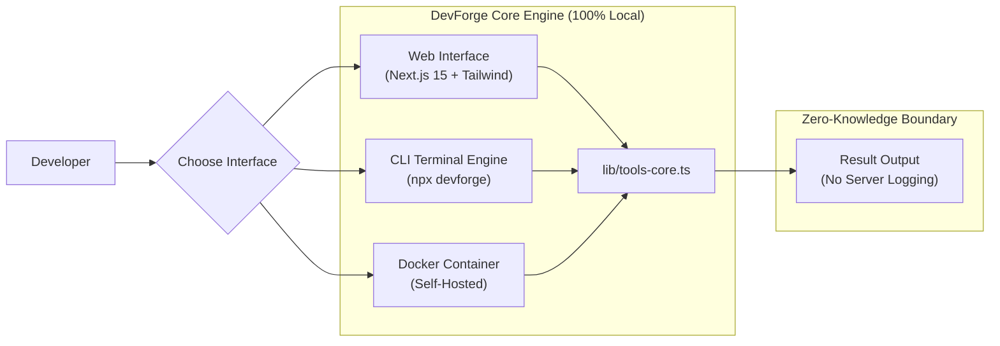

<div align="center">

# ⚡ DevForge — The Developer's Swiss Army Knife

**The ultimate open-source suite of essential developer utilities. 100% offline-first, client-side, and privacy-friendly.**

[](https://github.com/yhajizada/devforge)
[](https://nextjs.org/)
[](https://www.typescriptlang.org/)
[](https://docker.com)
[](#-privacy-first)
[](LICENSE)

[Live Web App](#) · [CLI Usage](#-cli-usage) · [Docker Self-Host](#-docker-deployment) · [Supported Tools](#-included-tools) · [Contributing](CONTRIBUTING.md)

</div>

---

## 💡 Why DevForge?

Every day, developers paste **sensitive JWT tokens, API keys, JSON payloads, and passwords** into shady online formatters and converters that log them to third-party servers.

**DevForge solves this forever:**
- 🔒 **Zero Telemetry / 100% Client-Side**: All parsing, hashing, and formatting runs inside your browser sandbox or local machine.
- ⚡ **Triple-Interface**: Use it as a blazing fast **Web App**, an instant **CLI** in your terminal, or self-host via **Docker**.
- 🌓 **Aesthetic Dark & Light Mode**: Clean, distraction-free interface built with Tailwind CSS.
- 🚀 **Offline-First**: Works without an internet connection.

---

## 🧰 Included Tools

| Category | Tool | Description | CLI Support |
|---|---|---|:---:|
| 🔐 **Security** | **JWT Debugger & Decoder** | Inspect header, claims, issued/expiration timestamps | `devforge jwt <token>` |
| 🔐 **Security** | **Crypto Hash Generator** | Instant SHA-256 and SHA-512 cryptographic digests | `devforge hash <text>` |
| 🔑 **Generators** | **UUID v4 & Secret Key** | Cryptographically secure identifiers & salts | `devforge uuid [count]` |
| 🧪 **Generators** | **Mock Data Synthesizer** | Generate Users, Orders, and Products in JSON | `devforge mock [type]` |
| 📄 **Formatters** | **JSON Formatter & Minifier**| Format, compress, validate, and convert JSON | — |
| 🔷 **Converters** | **JSON to TypeScript** | Auto-generate TypeScript interfaces from JSON in 1 click | — |
| 🔤 **Converters** | **Base64 Encoder / Decoder** | Bidirectional UTF-8 text and Base64 conversion | `devforge base64 <mode>` |
| 🗄️ **Database** | **SQL Query Beautifier** | Indent and format complex queries | — |

---

## 💻 CLI Usage

You don't even need to open a browser. Run DevForge directly from your terminal with `npx`:

```bash
# Generate 5 random UUIDs
npx devforge uuid 5

# Decode and inspect a JWT token
npx devforge jwt eyJhbGciOiJIUzI1NiIsInR5cCI6IkpXVCJ9...

# Generate a 256-bit SHA-256 hash
npx devforge hash "super-secret-password" sha256

# Encode text into Base64
npx devforge base64 encode "Hello World"

# Generate 3 mock users in JSON format
npx devforge mock users 3
```

---

## 🐳 Docker Deployment

Self-host DevForge in your private homelab, Kubernetes, or VPS with one command:

```bash
# Pull and run with Docker
docker run -d -p 3000:3000 --name devforge yhajizada/devforge:latest

# Or using docker-compose
docker-compose up -d
```

Navigate to `http://localhost:3000` to access your private DevForge instance.

---

## 🚀 Local Development

```bash
# 1. Clone repository
git clone https://github.com/yhajizada/devforge.git
cd devforge

# 2. Install dependencies
npm install

# 3. Launch dev server
npm run dev

# 4. Run automated test suite
npm run test
```

---

## 🏗️ Architecture



---

## 🤝 Contributing

Contributions are what make the open-source community so vibrant! 

Want to add a new tool? Check out our [Contributing Guide](CONTRIBUTING.md) — you can add any new developer utility in **under 10 minutes**!

---

## ⭐ Star History

If you find DevForge helpful, consider giving it a ⭐ on GitHub! It helps more developers discover secure, client-side tools.

---

## 📄 License

Distributed under the **MIT License**. See [`LICENSE`](LICENSE) for details.

<div align="center">
  <sub>Engineered with ❤️ for developers by Yusif Hajizada and open-source contributors.</sub>
</div>
